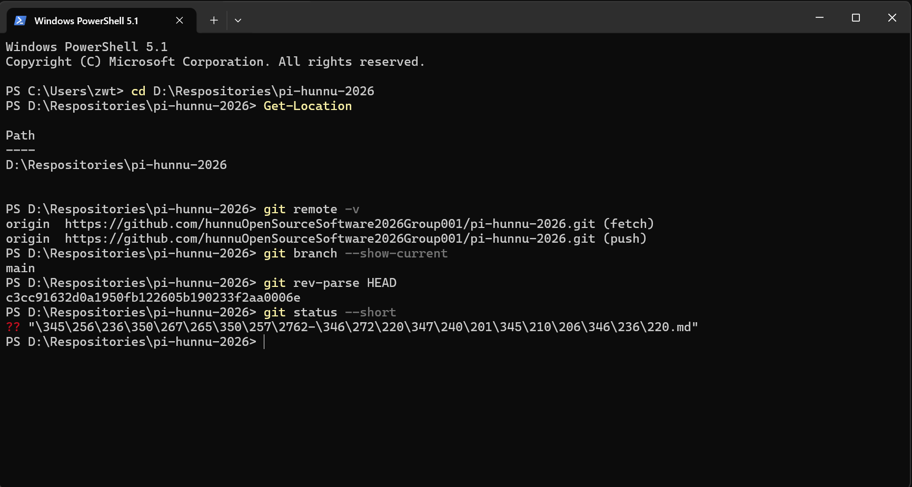
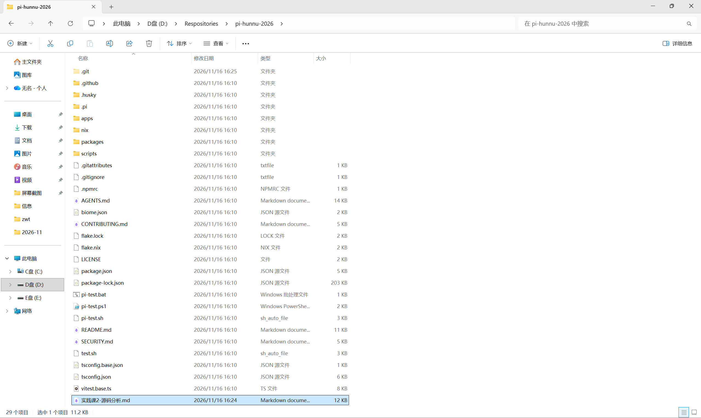
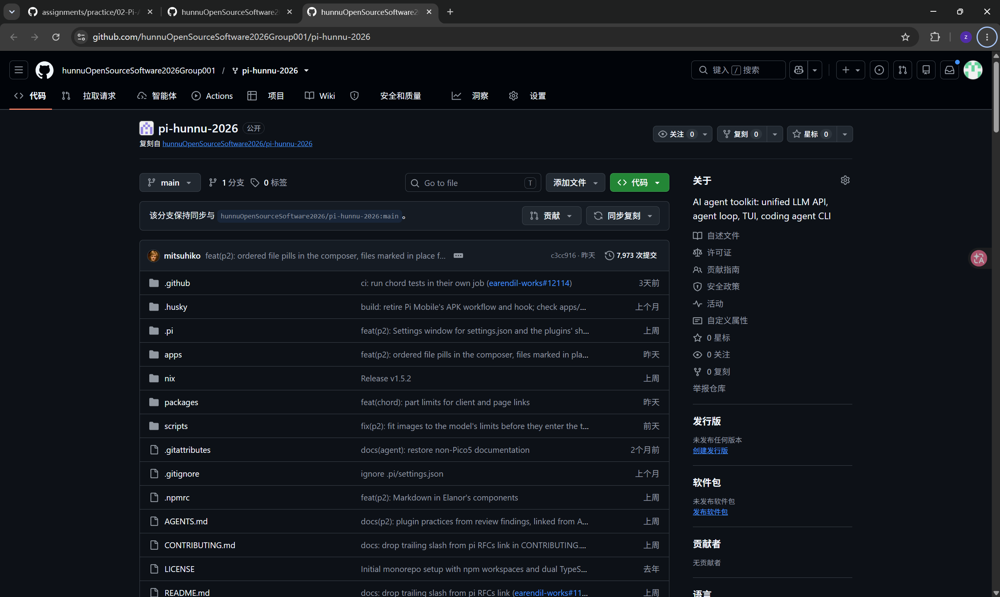
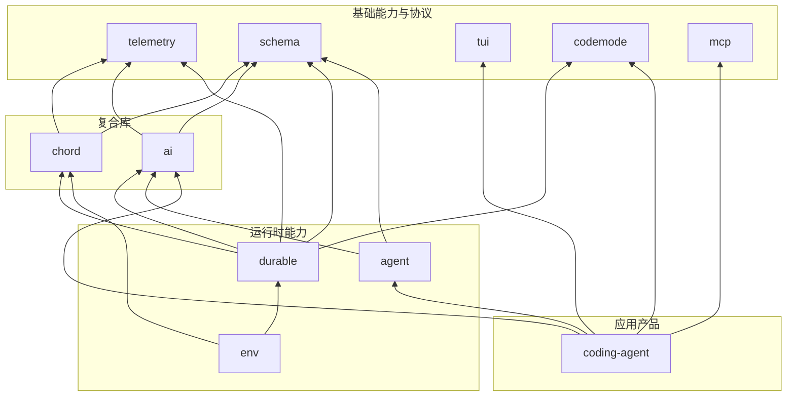

# 实践课2：组织建仓与源码分析

> 姓名拼音：张玟涛　学号：2024302204075　本人重点分析模块：**durable、coding-agent**（其余依据清单逐项核对）
>
> 本报告基于本地仓库 `D:\Respositories\pi-hunnu-2026` 的 `main` 分支快照整理，截图均来自本机实际操作。

## 一、源码获取与版本确认

本机仓库根目录为 `D:\Respositories\pi-hunnu-2026`。本地检查结果：

- clone 地址（即 origin）：<https://github.com/hunnuOpenSourceSoftware2026Group001/pi-hunnu-2026.git>
- 当前分支：`main`
- 完整提交编号：`c3cc91632d0a1950fb122605b190233f2aa0006e`
- `git status --short`：截图时显示一个未跟踪文件 `??`，即本报告 Markdown 文件；因此当时工作区并非完全干净。
- 组织仓库地址可在上述链接打开确认；源码目录证据应使用本机文件资源管理器/终端截图，不能用网页截图替代。

复核命令（仓库根目录执行）：

```powershell
Get-Location
git remote -v
git branch --show-current
git rev-parse HEAD
git status --short
```

**截图 S1：本地仓库来源与版本**



**源码目录截图**：展示本地 `pi-hunnu-2026` 根目录及 `packages` 子目录。



**组织仓库网页截图**：展示 GitHub 上的小组组织和仓库名称。



Issue 正文仍需粘贴实际 clone URL、个人报告链接和小组仓库链接。

## 二、构建命令和构建顺序

根目录 `package.json` 的 `build` 是串行 shell 脚本，按以下顺序进入模块目录并执行各自 `npm run build`：

`telemetry → schema → chord → tui → codemode → mcp → ai → durable → env → agent → coding-agent`

`build:offline` 同序执行，但把 `ai` 的命令换成 `build:offline`。这是根脚本定义的执行次序，不等于所有相邻模块之间都有依赖边。

根目录 `npm run build` 读取根 `package.json` 的 `scripts.build`，其职责是调度模块 build；根脚本没有统一编译器配置。各模块再使用自己的脚本/config：本次所列模块多数在 `build` 中调用 `tsc -p tsconfig.build.json`，`ai` 先运行模型数据生成，再离线检查、TypeScript 编译和 provider 数据复制；`coding-agent` 先执行 `build:unbundled`（tsc、入口可执行处理、复制资源），再由 `scripts/build-coding-agent-bundle.mjs` 生成 bundle。

共同的编译选项还受根 `tsconfig.base.json` 及根/模块 tsconfig 的 `extends` 关系影响；应结合各自 `tsconfig.build.json` 核实包含文件与输出目录。一般编译产物写入模块 `dist/`，供 `package.json` 中 `main`、`types`、`exports` 引用。`tui` 另有 `build:native:*` 平台脚本，但根普通 `build` 没有调用这些 native build。

## 三、模块分析表

表中“直接内部依赖”只列 `dependencies` 中的仓库内部包（`@earendil-works/*`）；`devDependencies` 和可选 peer dependency 不作为运行时直接依赖。依据优先级为本次版本的 `package.json`、build 配置、README 和实际源码入口。构建动作以各自 `scripts.build` 为准。

| 子文件夹 | 主要实现 | 本模块 build 执行/生成 | 直接内部依赖 | 依据（路径均相对仓库根） |
|---|---|---|---|---|
| telemetry | vendor-neutral 的 tracing/metrics 等 telemetry 合约、内存实现及测试工具 | `tsc -p tsconfig.build.json`，生成 `dist` JS 和声明 | 无 | `packages/telemetry/README.md`、`src/index.ts`、`src/metrics.ts`、`package.json` |
| schema | JSON Schema 校验、编译器、类型/格式辅助 | `tsc -p tsconfig.build.json`，生成 `dist` | 无 | `packages/schema/README.md`、`src/validator.ts`、`src/compiler.ts`、`package.json` |
| chord | 跨进程 app/object runtime，含状态、store、插件、HTTP/workers、Web/TUI surfaces | `tsc -p tsconfig.build.json`，生成多个 exports 对应的 `dist` 子路径 | schema、telemetry | `packages/chord/README.md`、`src/index.ts`、`package.json` dependencies/exports |
| tui | 终端差分渲染、组件、输入/编辑器和终端适配 | `tsc -p tsconfig.build.json`，生成 `dist`；native build 需另外按平台执行 | 无 | `packages/tui/README.md`、`src/index.ts`、`package.json` |
| codemode | 在沙箱中执行 JavaScript，仅通过注入工具授予能力，含 QuickJS/WASM/worker runtime | `tsc -p tsconfig.build.json`，生成 `dist` 多入口 | 无 | `packages/codemode/README.md`、`src/index.ts`、`src/runtime/`、`package.json` |
| mcp | MCP 客户端协议、stdio/HTTP transport、OAuth 与内容/配置处理 | `tsc -p tsconfig.build.json`，生成 `dist` | 无 | `packages/mcp/README.md`、`src/client.ts`、`src/transports/`、`package.json` |
| ai | 统一 LLM API/provider、模型目录与流式消息/调用 | `npm run generate-models` 后进入 `build:offline`：校验模型数据、tsc、整理并复制 provider data 到 `dist` | schema、telemetry | `packages/ai/README.md`、`src/index.ts`、`catalog/`、`package.json` |
| durable | 可持久化会话、文档、任务/agent harness、工具和多种存储适配 | `tsc -p tsconfig.build.json`，生成 `dist` exports | chord、ai、codemode、schema、telemetry | `packages/durable/README.md`、`src/index.ts`、`src/harness/`、`package.json` |
| env | Pi Durable 的执行环境抽象、远端 SSH 连接及进程/文件/终端 API；另含 Rust daemon | 普通 build 是 TypeScript `tsc -p tsconfig.build.json`；daemon 用独立 `build:daemon`（Cargo），不是普通 build 的组成 | chord、durable | `packages/env/README.md`、`src/index.ts`、`src/remote-env.ts`、`daemon/Cargo.toml`、`package.json` |
| agent | 通用 agent 核心，提供 transport 抽象、状态管理、附件等，不含 coding 专用 CLI 体验 | `tsc -p tsconfig.build.json`，生成 `dist` | ai、schema | `packages/agent/README.md`、`src/index.ts`、`package.json` |
| coding-agent | 面向编码任务的 CLI/SDK，包含工具、会话、交互 TUI、扩展、MCP、RPC 等 | `npm run build:unbundled`（tsc、CLI/RPC 入口处理、资源复制），随后 bundle 脚本输出 bundle | agent、ai、codemode、mcp、tui | `packages/coding-agent/README.md`、`src/main.ts`、`src/core/`、`src/extensions/`、`package.json` |

### 模块图与可编辑图源

箭头统一为“使用方 → 被依赖方”，仅画 `dependencies` 中可由清单确认的直接内部关系。虚线表示开发依赖；该次清单中的 11 个目标模块之间未发现需在图中绘出的内部开发依赖。`chord` 的 `esbuild`、`react`、`ws` 是 optional peer dependencies，且不是上述 11 个模块；在图例说明，不将它们误画成此图的内部运行依赖。`packages/evals` 的 devDependencies 指向 coding-agent/ai，但 evals 不属于题目指定的 11 个构建模块，因此不并入主体依赖图。

层级按依赖拓扑与用途划分：基础契约/工具（telemetry、schema、tui、codemode、mcp），复合库（chord、ai），持久化/环境/通用 agent 能力（durable、env、agent），面向用户的编码产品（coding-agent）。同层不代表彼此依赖；依赖层次以直接边为准。

图中实线采用 `使用方 --> 被依赖方`。可编辑源为 Mermaid 文本，直接在支持 Mermaid 的 Markdown/GitHub 中渲染；可复制到 Mermaid Live Editor 继续编辑。



## 四、问题回答

### 1. 根目录与子模块中的 `npm run build` 分别读取什么配置、执行什么工作？

根目录命令从根 `package.json` 的 `scripts.build` 读取固定调度链，不负责自身源码编译，也不读取一个“全仓统一 build 配置”来一次性编译所有包。npm workspaces 帮助安装/管理依赖，但根 build 明确逐目录运行命令。进入子模块后，npm 根据该模块自己的 `package.json` 找 `scripts.build`；若脚本调用 TypeScript，则 `tsc -p tsconfig.build.json` 使用模块 build tsconfig，继承根 tsconfig 公共选项，并产出对应 `dist`。特殊之处是 `ai` 的模型数据生成/校验和数据复制，`coding-agent` 的分阶段打包；`env` 的 Rust daemon 也有独立脚本，不会仅因普通 TS build 而被编译。

### 2. 构建顺序和模块依赖有什么关系？相邻构建的模块是否一定互相依赖？

构建顺序需要满足依赖先构建的要求，确保后续模块引用内部包时可解析到正确产物；但脚本是人为定义的串行次序，不代表相邻两项必有边。例如 `schema` 后面是 `chord`，确有 `chord → schema`；`chord` 后面是 `tui`，但 `chord` 的 package.json 没有指向 pi-tui 的依赖；`tui` 后面是 `codemode`，二者也没有直接内部依赖。先后顺序可出于统一编排、避免并行或可扩展性，不可仅凭序列推断依赖。

### 3. 一条涉及至少三个模块的依赖路径及分工

路径：`coding-agent → agent → ai → schema`（箭头表示使用方依赖被依赖方）。`coding-agent` 提供面向开发者的 CLI/交互和工具编排；通用 `agent` 把消息/状态/transport 抽象为可复用的 agent 核心；`ai` 统一不同 LLM provider 的模型请求与响应；`schema` 为消息/provider 等结构提供可复用的 JSON Schema 校验能力。该路径说明上层产品不需要自行实现模型厂商协议与底层结构校验。这里的直接边由各包 `dependencies` 清单证明：coding-agent 直接依赖 agent；agent 直接依赖 ai 与 schema；ai 直接依赖 schema。
